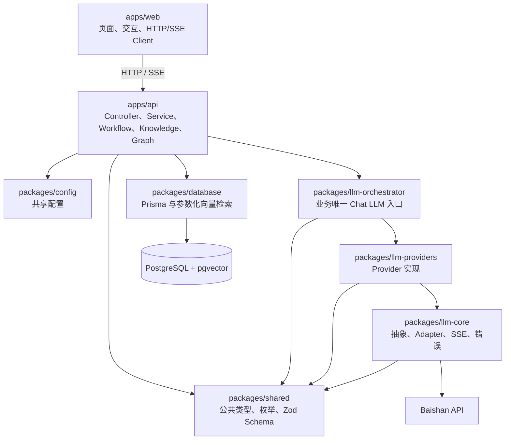

# Architecture Overview

> Version: 1.5.0<br>
> Status: Current - Architecture Source of Truth<br>
> Last reviewed: 2026-08-12<br>
> Scope: 当前技术栈、模块职责、依赖方向和不可变边界。

端到端执行与数据流见 [`system-design.md`](./system-design.md)；具体行为以 `specs/` 和 `contracts/` 为准。

## 技术栈

| 层         | 技术                                              |
| ---------- | ------------------------------------------------- |
| 前端       | Next.js 15、React、TanStack Query、Tailwind CSS 4 |
| 后端       | NestJS 11、TypeScript                             |
| 数据库     | PostgreSQL 16、pgvector、Prisma 6                 |
| Agent 编排 | LangGraph                                         |
| 文档处理   | LangChain loaders / text splitters                |
| AI 接入    | Baishan OpenAI-compatible API                     |
| Monorepo   | pnpm 10、Turborepo                                |

## 组件边界



### Web

- `app/` 只承载路由和页面组装。
- API 调用集中在 feature API 层和统一 Client。
- 展示组件不直接访问 API、数据库或模型。
- 请求状态由 TanStack Query 管理；不复制到额外全局 Store。

### API

- Controller 只处理 HTTP/SSE 绑定、DTO 和响应映射。
- Service 承载业务逻辑；普通数据访问通过 Prisma。
- `modules/knowledge/` 负责来源导入、索引、检索和引用，不调用 Chat LLM。
- `modules/workflow/` 负责固定阶段、Graph、Tool、产物和用户可见状态。
- 向量相似度 Raw SQL 只允许位于数据库包的单一 Repository，并使用参数化查询。

### AI 基础层

```text
业务代码
  → llm-orchestrator
  → llm-providers
  → llm-core OpenAI-compatible Adapter
  → Baishan API
```

- 业务代码不能直接调用 Provider、Adapter、OpenAI SDK 或白山 Client。
- Chat LLM 与 Embedding 使用独立 Provider 配置。
- Orchestrator 负责路由、重试、首个 delta 前降级、Token 和成本计算，不依赖数据库。
- Workflow 负责持久化项目成本、执行日志和用户可见状态。

## Workspace 依赖方向

| Workspace                   | 允许依赖的内部包                                   |
| --------------------------- | -------------------------------------------------- |
| `packages/shared`           | 无                                                 |
| `packages/config`           | 无                                                 |
| `packages/database`         | 无                                                 |
| `packages/llm-core`         | `shared`                                           |
| `packages/llm-providers`    | `llm-core`, `shared`                               |
| `packages/llm-orchestrator` | `llm-core`, `llm-providers`, `shared`              |
| `apps/api`                  | `config`, `database`, `llm-orchestrator`, `shared` |
| `apps/web`                  | 无内部包；通过 HTTP/SSE 访问 API                   |

`apps/api` 可以直接依赖已批准的 LangChain、LangGraph 和 PostgreSQL checkpointer 包；其他 workspace 不得引入 Agent 聚合包。依赖方向由 `pnpm harness:check` 强制执行。

API 中只有以下位置可以 import `LlmOrchestratorService`：

- `apps/api/src/llm/`：应用组装。
- `apps/api/src/health/` 和 `apps/api/src/modules/models/`：仅调用 `healthCheck()`。
- `apps/api/src/modules/workflow/`：模型调用、工作流、融合和产物生成。

## 不可变边界

- 保持单体 Web、单体 API 和单 Agent Workflow，不拆微服务。
- 不引入 Multi-Agent、Supervisor、运行时 MCP、开放式 ReAct 或任意 Tool 注册。
- Agent Tool 固定为四个只读能力，不得写数据库、修改代码或推进状态机。
- 不引入 Redis、Kafka、WebSocket、GraphQL、Kubernetes 或独立向量数据库。
- API Key 只存在 API Server 环境，不能进入浏览器、日志、仓库或产物。
- 文档和代码内容属于不可信上下文，不能改变权限、项目 ID、模型路由、Tool 白名单或合法状态转换。
- Graph checkpoint 是恢复来源；项目、消息、工作流状态和产物是用户可见读模型。
- Graph 重放不得重复写入内部消息、产物、执行日志、Token 或成本汇总。

知识库与 Agent Graph 的详细契约见 [`knowledge-base.spec.md`](../specs/knowledge-base.spec.md) 和 [`agent-graph.spec.md`](../specs/agent-graph.spec.md)。
