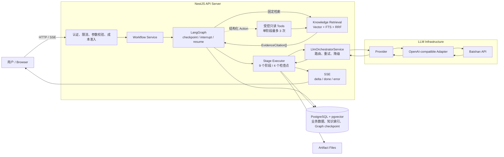
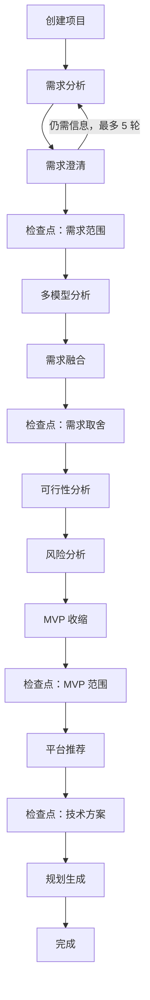
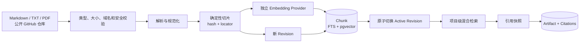
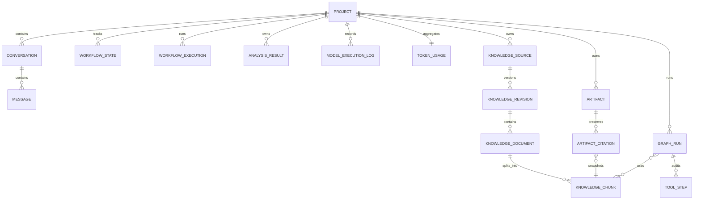

# System Design

> Version: 1.5.0<br>
> Status: Current<br>
> Last reviewed: 2026-08-12<br>
> Scope: 当前端到端执行、知识索引、恢复和核心数据关系。

本文档只展示系统数据流。模块职责见 [`architecture-overview.md`](./architecture-overview.md)，详细行为见 [`workflow.spec.md`](../specs/workflow.spec.md)、[`knowledge-base.spec.md`](../specs/knowledge-base.spec.md) 和 [`agent-graph.spec.md`](../specs/agent-graph.spec.md)。

## 运行时主链路



所有 Chat LLM 调用只经过 `LlmOrchestratorService`。没有知识源、没有检索结果或关闭知识检索时，工作流沿用无证据路径并明确标记限制。

## 规划工作流



检查点讨论通过 SSE 返回。用户确认时保存结构化决策快照；后续阶段只接收已确认决定和当前活动会话的受限上下文。

## 知识索引与引用



- 新 revision 完整成功后才替换旧 active revision；失败时继续使用旧版本。
- 检索在数据库层同时过滤 `project_id` 和 active revision。
- 来源内容作为不可信上下文，不能控制权限、状态或数据库写入。
- 来源删除后新检索不可命中，历史产物仍保留生成时引用快照。

## 恢复与增量重生成

```text
节点成功
  → 原子提交内部业务副作用
  → 保存 Graph checkpoint
  → 进入下一节点或人工 interrupt

节点失败或进程中断
  → 复用最近 Graph Run
  → 从最近成功 checkpoint 恢复
  → 重放时复用已提交的内部结果

知识来源变化
  → 服务端计算受影响产物闭包
  → 只重新生成受影响产物
  → 未受影响产物保持不变
```

运行模式与回退开关见 [`deployment.md`](./playbooks/deployment.md)。

## 核心数据关系



字段、约束和索引以 [`database.spec.md`](../specs/database.spec.md) 与 Prisma Schema 为准。
